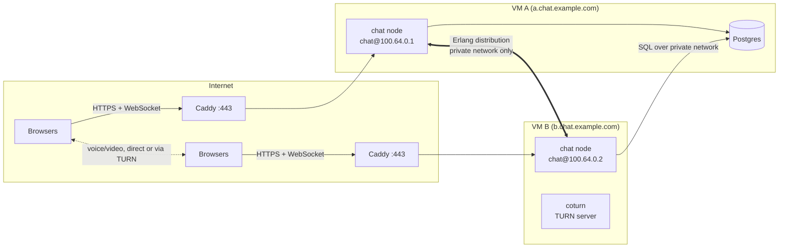

# Deploying BEAM Chat on two virtual machines

This guide sets up one chat that runs on two separate virtual machines (VM A and
VM B). They can be at different cloud providers, in different regions, or one
can be at home. Users can connect to either machine and they all see the same
channels, messages, members and voice rooms. If one machine goes down, the other
keeps serving.


## What you end up with



There are four kinds of traffic, and each one needs its own path:

| Traffic | Between | How it's carried |
|---|---|---|
| Web page and chat (WebSocket) | Browser ↔ either VM | HTTPS on port 443, via Caddy with a real certificate |
| Cluster traffic (presence, messages, signaling) | VM A ↔ VM B | Erlang distribution over a **private** network (Tailscale or WireGuard), never the open internet |
| Database | VM B → Postgres on VM A | SQL over the same private network |
| Voice, video, screen sharing | Browser ↔ browser | WebRTC: direct when possible, otherwise relayed through a TURN server |

## Part 1: the settings

Each VM runs one node with `mix chat`. Every setting can be a flag or an
environment variable (handy in a systemd `EnvironmentFile`):

| Flag | Variable | What it does |
|---|---|---|
| `--name chat@100.64.0.1` | `CHAT_NODE_NAME` | The node's name. The part after `@` is how other nodes reach it, so use the VM's **private** IP (Erlang needs an IP or a full hostname with dots, so a short name like `vm-a` won't work). |
| `--dist-ip 100.64.0.1` | `CHAT_DIST_IP` | The interface node-to-node traffic listens on. Defaults to the IP in the node name, and is required if the name uses a hostname, so the node never listens somewhere you didn't choose. |
| `--dist-ports 9100-9105` | `CHAT_DIST_PORTS` | The port range for node-to-node traffic (default 9100–9105 for networked nodes), so the firewall can allow exactly that. |
| `--join chat@100.64.0.2` | `CHAT_JOIN` | Node(s) to connect to, comma-separated. Retried every 5 seconds, so the VMs can start in any order and reconnect after an outage. One is enough; Erlang connects the rest. |
| `--public-url https://a.chat.example.com` | `CHAT_PUBLIC_URL` | How browsers reach this node. Shown in the server rail and used for failover. Pages on one node may open connections to the others' public URLs. |
| `--no-https` | `CHAT_HTTPS=false` | Don't serve the built-in self-signed HTTPS port; Caddy handles HTTPS. |
| `--host 127.0.0.1` | | Where the web server listens. Behind Caddy, only on the VM itself. |
| | `CHAT_COOKIE` | The cluster's shared secret, at least 20 characters, the same on every node. **Required** for any node reachable from another machine: whoever knows it can run any code on the node. |
| | `CHAT_INVITE_CODE` | If set, the login screen asks for this code. It's sent over the WebSocket, not in the URL, so proxies don't log it. |
| | `CHAT_DEMO_COMMANDS=false` | Turns off `/crash` and `/halt`, which let any user break things on purpose. |
| | `CHAT_STUN_URLS`, `CHAT_TURN_URLS`, `CHAT_TURN_SECRET` | STUN/TURN servers for voice and video across networks. Browsers get a TURN login valid for 12 hours, signed with the secret; the secret itself never leaves the server. |
| | `DATABASE_URL` | The shared Postgres. |
| | `GIPHY_API_KEY` | Optional, for GIF search. |

`mix chat` refuses to start if a networked node has no secret cookie, if
`--nodes` is used on a networked node (it starts extra nodes on the *same*
machine), or if a TURN URL is set without its secret.

Every WebSocket connection is checked against the browser's `Origin`. A page
may connect if it comes from the same hostname, or from another node's public
URL. This stops other websites from opening chat connections in a visitor's
browser.

## Part 2: what you need

**Two VMs**, at the same or different providers:

| | Minimum | Comfortable |
|---|---|---|
| CPU | 1 vCPU | 2 vCPU |
| Memory | 1 GB (VM A runs Postgres too, so give it 2 GB) | 2–4 GB |
| Disk | 10 GB | 20 GB+ (message history grows slowly: text is ~200 bytes per message) |
| OS | Ubuntu 24.04 LTS (any Linux works) | |
| Network | A public IPv4 address on at least one VM (for TURN) | Public IPv4 on both |

A chat node uses roughly 150–250 MB of memory. The servers do little work for
voice and video, because media goes browser to browser. The exception is the
TURN server: every call it relays passes through it twice, in and out. Plan on
about 1.1 Mbps of TURN bandwidth per relayed camera stream, and 3 Mbps per
relayed screen share.

**Also:**
- A domain name, e.g. `example.com`, where you can add DNS records.
- A free [Tailscale](https://tailscale.com) account, or WireGuard if you'd rather configure the private network yourself.
- Optional: a GIPHY API key.

**One VM at home, behind a home router?** That works. Tailscale gets the private
link through home routers without port forwarding. For the public side, use
[Cloudflare Tunnel](https://developers.cloudflare.com/cloudflare-one/connections/connect-networks/)
instead of Caddy and opening port 443. Run TURN on the cloud VM.

## Part 3: network plan

**DNS records** (point each at the VM's public IP):

| Name | Type | Points to |
|---|---|---|
| `a.chat.example.com` | A | VM A public IP |
| `b.chat.example.com` | A | VM B public IP |
| `turn.chat.example.com` | A | VM B public IP |

**Firewall.** Open only these ports to the internet. Everything else stays on
the private network:

| VM | Port | Protocol | From | For |
|---|---|---|---|---|
| both | 22 | TCP | your IP | SSH |
| both | 80, 443 | TCP | anywhere | Caddy (80 is only for certificate setup and redirects) |
| B | 3478 | UDP + TCP | anywhere | TURN |
| B | 49152–65535 | UDP | anywhere | TURN relay traffic |
| both | 4369, 9100–9105 | TCP | **private network only** | Erlang port mapper (epmd) and distribution |
| A | 5432 | TCP | **private network only** | Postgres |

Clocks: message timestamps are set by the node that writes them, so keep both
VMs on NTP. Cloud images have it on by default; check with `timedatectl`.

## Part 4: step by step

### 1. Create the VMs and firewall

Create both VMs with Ubuntu 24.04, add your SSH key, and set up the firewall
from the table above. With `ufw`:

```sh
sudo ufw allow 22/tcp
sudo ufw allow 80,443/tcp
sudo ufw allow in on tailscale0        # everything over the private network
# VM B only (TURN):
sudo ufw allow 3478
sudo ufw allow 49152:65535/udp
sudo ufw enable
```

### 2. Private network between the VMs

On **both** VMs:

```sh
curl -fsSL https://tailscale.com/install.sh | sh
sudo tailscale up --hostname vm-a      # vm-b on the other one
tailscale ip -4                        # note the 100.x.y.z address
```

Check the link: `ping <VM B's 100.x address>` from VM A. The rest of this
guide uses `100.64.0.1` for VM A and `100.64.0.2` for VM B; substitute yours.

### 3. Install the runtime and the app

On **both** VMs, install Erlang/OTP 27+ and Elixir 1.18+ (for example with
[mise](https://mise.jdx.dev): `mise use -g erlang@latest elixir@latest`), plus
Docker on VM A. Then:

```sh
git clone git@github.com:svopper/claucord.git /opt/beam-chat
cd /opt/beam-chat
MIX_ENV=prod mix deps.get
MIX_ENV=prod mix compile
```

**Both VMs must run the same version of the code.** The nodes exchange Erlang
terms and share one database schema, so always deploy to both together.

### 4. Postgres (VM A)

Make Postgres listen on VM A's private address only, with a real password. Put
this in `/opt/beam-chat/docker-compose.override.yml` (it extends
`docker-compose.yml`):

```yaml
services:
  db:
    environment:
      POSTGRES_PASSWORD: ${DB_PASSWORD}
    ports: !override
      - "100.x.y.z:5432:5432"   # VM A's Tailscale IP
```

```sh
export DB_PASSWORD="$(openssl rand -hex 24)"   # save it, both VMs need it
docker compose up -d --wait
```

Both VMs then use
`DATABASE_URL=ecto://postgres:<password>@100.64.0.1:5432/beam_chat` (VM A's
Tailscale IP).

### 5. Shared secrets

Generate these once and use the same values on both VMs:

```sh
openssl rand -hex 32   # CHAT_COOKIE
openssl rand -hex 32   # CHAT_TURN_SECRET
```

### 6. Run the chat node as a service

`/etc/beam-chat.env` on **VM A**. On VM B, swap the two Tailscale IPs and use
`https://b.chat.example.com`:

```sh
MIX_ENV=prod
DATABASE_URL=ecto://postgres:<password>@100.64.0.1:5432/beam_chat
CHAT_NODE_NAME=chat@100.64.0.1        # this VM's Tailscale IP
CHAT_JOIN=chat@100.64.0.2             # the other VM
CHAT_COOKIE=<cookie>
CHAT_PUBLIC_URL=https://a.chat.example.com
CHAT_STUN_URLS=stun:turn.chat.example.com:3478
CHAT_TURN_URLS=turn:turn.chat.example.com:3478,turn:turn.chat.example.com:3478?transport=tcp
CHAT_TURN_SECRET=<turn secret>
CHAT_DEMO_COMMANDS=false
CHAT_INVITE_CODE=<optional, shared with your users>
GIPHY_API_KEY=<optional>
```

The log shows `connected to chat@100.64.0.2` once the other VM is up, and
`can't reach …; retrying every 5s` while it isn't.

`/etc/systemd/system/beam-chat.service`:

```ini
[Unit]
Description=BEAM Chat node
After=network-online.target tailscaled.service
Wants=network-online.target

[Service]
User=chat
WorkingDirectory=/opt/beam-chat
EnvironmentFile=/etc/beam-chat.env
ExecStart=/usr/bin/env mix chat --port 4000 --host 127.0.0.1 --no-https
Restart=always

[Install]
WantedBy=multi-user.target
```

```sh
sudo systemctl enable --now beam-chat
journalctl -u beam-chat -f
```

The node listens on 127.0.0.1:4000 only; Caddy is its public face. Don't use
`--nodes`: it starts extra nodes on the *same* machine.

### 7. HTTPS with Caddy

On each VM, install Caddy (see [caddyserver.com/docs/install](https://caddyserver.com/docs/install)),
then put this in `/etc/caddy/Caddyfile`:

```
a.chat.example.com {
    reverse_proxy 127.0.0.1:4000
}
```

(`b.chat.example.com` on VM B.) Run `sudo systemctl reload caddy`. Caddy gets
a Let's Encrypt certificate automatically and passes WebSockets through. With a
real certificate, browsers allow the microphone and camera without warnings.

### 8. TURN for voice and video (VM B)

Most calls between two home networks connect directly. Calls from strict
networks (corporate, some mobile carriers) need a relay. Install coturn:

```sh
sudo apt install coturn
```

`/etc/turnserver.conf`:

```
listening-port=3478
min-port=49152
max-port=65535
realm=turn.chat.example.com
use-auth-secret
static-auth-secret=<turn secret>
fingerprint
no-cli
no-multicast-peers
# Don't let the relay reach private addresses (your tailnet, cloud metadata):
denied-peer-ip=10.0.0.0-10.255.255.255
denied-peer-ip=100.64.0.0-100.127.255.255
denied-peer-ip=169.254.0.0-169.254.255.255
denied-peer-ip=172.16.0.0-172.31.255.255
denied-peer-ip=192.168.0.0-192.168.255.255
```

```sh
sudo systemctl enable --now coturn
```

The chat server hands each browser a TURN login when it connects: the username
is `<expiry-unix-time>:<id>`, and the password is the base64 HMAC-SHA1 of that
username, keyed with the shared secret. coturn checks it with the same secret,
so the secret never leaves the servers.

### 9. Check it works

- `journalctl -u beam-chat` on each VM shows `connected to chat@<other VM>`.
- For a closer look, open a shell on VM A with
  `iex --name ops@100.64.0.1 --cookie <cookie>`, run `Node.connect(:"chat@100.64.0.1")`, then
  `:erpc.call(:"chat@100.64.0.1", Node, :list, [])`. It lists the other node.
- Open `https://a.chat.example.com` and `https://b.chat.example.com` in two browsers. Both users appear in the member list, grouped by node, and messages go both ways.
- In any channel, `/where` shows which VM runs the channel's process.
- Start a voice call between a phone on mobile data and a laptop on Wi-Fi. To test the TURN path, set `iceTransportPolicy: "relay"` temporarily and confirm the call still connects.

## Running it

**Updating:** pull the same commit on both VMs. Migrations run automatically
when a node starts (Ecto locks the migrations table, so two nodes starting at
once is safe).
- **Small changes** (page tweaks, bug fixes that don't change the messages
  between nodes): restart one VM at a time. Its users fail over to the other
  VM and back, with no downtime.
- **Changes to what nodes send each other** (presence or voice group keys,
  channel messages) or to the database schema: stop both, update both, then
  start both, because mixed versions can misread each other.

**Backups:** only Postgres holds data. Back it up from VM A, e.g. a nightly
`docker compose exec db pg_dump -U postgres beam_chat | gzip > backup.sql.gz`,
and copy it off the machine.

**What happens when things fail:**

| Failure | Effect |
|---|---|
| VM B goes down | Its users' browsers reconnect to VM A automatically. Channels that ran on VM B restart on VM A and reload their history from Postgres. Voice calls between browsers that are already connected keep going. |
| VM A goes down | Same failover to VM B, **but Postgres is on VM A**, so no new messages can be saved until it's back. Use a managed Postgres, reachable from both VMs, to remove this weak spot. |
| The private link between the VMs drops | Each VM keeps serving its own users, but they can't see the other side's users or messages. Erlang notices after about 60 seconds (`net_ticktime`). When the link returns, the nodes reconnect by themselves, the channel lists merge, presence catches up, and duplicate channel processes are resolved by `:global` (history is safe in Postgres). VM B can't save messages while it can't reach Postgres. |

**Latency:** each message is saved to Postgres before it's broadcast, so VM B's
users wait one round trip to VM A per message. Keeping both VMs in the same
region (under ~20 ms apart) keeps this unnoticeable. Users themselves can be
anywhere.

**More than two VMs:** the same steps apply. Add a third VM with its own DNS
name and `CHAT_JOIN` pointing at any existing node (or several, comma-separated,
so it can join even if one is down). Erlang connects every node to every other
one.
